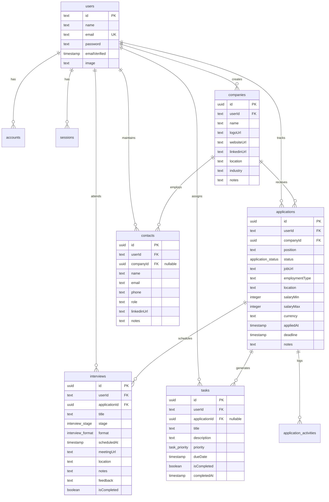

# 04. Database Schema Design & ERD

Dokumen ini memuat spesifikasi desain database relasional PostgreSQL (via Drizzle ORM) untuk menyempurnakan tabel yang masih kosong serta merancang relasi masa depan.

---

## 1. Entity-Relationship Diagram (ERD)



---

## 2. Blueprint Drizzle Schema untuk Modul Kosong

Berikut adalah implementasi TypeScript Drizzle ORM siap pakai untuk melengkapi file skema yang saat ini masih berukuran 0 byte:

### A. Skema Wawancara (`db/schema/interviews.ts`)

```typescript
import {
  boolean,
  index,
  pgEnum,
  pgTable,
  text,
  timestamp,
  uuid,
} from "drizzle-orm/pg-core";
import { users } from "./auth";
import { applications } from "./application";

export const interviewStageEnum = pgEnum("interview_stage", [
  "HR_SCREENING",
  "TECHNICAL_TEST",
  "USER_INTERVIEW",
  "SYSTEM_DESIGN",
  "CULTURE_FIT",
  "FINAL_OFFER",
  "OTHER",
]);

export const interviewFormatEnum = pgEnum("interview_format", [
  "ONLINE_GOOGLE_MEET",
  "ONLINE_ZOOM",
  "ONLINE_TEAMS",
  "PHONE_CALL",
  "ONSITE",
]);

export const interviews = pgTable(
  "interviews",
  {
    id: uuid("id").defaultRandom().primaryKey(),
    userId: text("user_id")
      .notNull()
      .references(() => users.id, { onDelete: "cascade" }),
    applicationId: uuid("application_id")
      .notNull()
      .references(() => applications.id, { onDelete: "cascade" }),
    title: text("title").notNull(),
    stage: interviewStageEnum("stage").default("HR_SCREENING").notNull(),
    format: interviewFormatEnum("format").default("ONLINE_GOOGLE_MEET").notNull(),
    scheduledAt: timestamp("scheduled_at", { withTimezone: true }).notNull(),
    meetingUrl: text("meeting_url"),
    location: text("location"),
    notes: text("notes"),
    feedback: text("feedback"),
    isCompleted: boolean("is_completed").default(false).notNull(),
    createdAt: timestamp("created_at", { withTimezone: true }).defaultNow().notNull(),
    updatedAt: timestamp("updated_at", { withTimezone: true }).defaultNow().notNull(),
  },
  (table) => [
    index("interviews_user_id_idx").on(table.userId),
    index("interviews_application_id_idx").on(table.applicationId),
    index("interviews_scheduled_at_idx").on(table.scheduledAt),
  ]
);
```

### B. Skema To-Dos / Tasks (`db/schema/tasks.ts`)

```typescript
import {
  boolean,
  index,
  pgEnum,
  pgTable,
  text,
  timestamp,
  uuid,
} from "drizzle-orm/pg-core";
import { users } from "./auth";
import { applications } from "./application";

export const taskPriorityEnum = pgEnum("task_priority", [
  "LOW",
  "MEDIUM",
  "HIGH",
  "URGENT",
]);

export const tasks = pgTable(
  "tasks",
  {
    id: uuid("id").defaultRandom().primaryKey(),
    userId: text("user_id")
      .notNull()
      .references(() => users.id, { onDelete: "cascade" }),
    applicationId: uuid("application_id").references(() => applications.id, {
      onDelete: "set null",
    }),
    title: text("title").notNull(),
    description: text("description"),
    priority: taskPriorityEnum("priority").default("MEDIUM").notNull(),
    dueDate: timestamp("due_date", { withTimezone: true }),
    isCompleted: boolean("is_completed").default(false).notNull(),
    completedAt: timestamp("completed_at", { withTimezone: true }),
    createdAt: timestamp("created_at", { withTimezone: true }).defaultNow().notNull(),
    updatedAt: timestamp("updated_at", { withTimezone: true }).defaultNow().notNull(),
  },
  (table) => [
    index("tasks_user_id_idx").on(table.userId),
    index("tasks_application_id_idx").on(table.applicationId),
    index("tasks_is_completed_idx").on(table.isCompleted),
  ]
);
```

### C. Skema Kontak Recruiter (`db/schema/contacts.ts`)

```typescript
import { index, pgTable, text, timestamp, uuid } from "drizzle-orm/pg-core";
import { users } from "./auth";
import { companies } from "./companies";

export const contacts = pgTable(
  "contacts",
  {
    id: uuid("id").defaultRandom().primaryKey(),
    userId: text("user_id")
      .notNull()
      .references(() => users.id, { onDelete: "cascade" }),
    companyId: uuid("company_id").references(() => companies.id, {
      onDelete: "set null",
    }),
    name: text("name").notNull(),
    role: text("role"),
    email: text("email"),
    phone: text("phone"),
    linkedinUrl: text("linkedin_url"),
    notes: text("notes"),
    createdAt: timestamp("created_at", { withTimezone: true }).defaultNow().notNull(),
    updatedAt: timestamp("updated_at", { withTimezone: true }).defaultNow().notNull(),
  },
  (table) => [
    index("contacts_user_id_idx").on(table.userId),
    index("contacts_company_id_idx").on(table.companyId),
  ]
);
```
